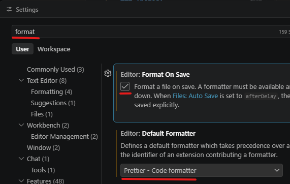

## Extensions

### Themes:

UI extensions:
Extensions --> Filter --> Category --> Themes
Option - VS Code:


- Interesting Theme is: **One Dark Pro**
- Interesting Icons are in: **Material icon Theme**
- Extension: **Prettier** - to improve file formatting, e.g. automatic indenting, adding semicolons at the of the line, when necessary, etc.
  - To enable it - you have to go to: Settings --> search `default formatter`
    
- Extension: **Live Server** - is for editing HTML files - it will setup a virtual page of your project. So, you can preview changes in real life (well, you have to save the file first) - just open web browser as `http://127.0.0.1:5500/page.html`  
	- Quick overview [here](https://youtu.be/lWEKiak0WVU?si=jhOABVXuWThpZLwe&t=1393)

To manually change Themes:


# Command palette
- Execute commands in VS Code - press: `Ctrl + Shift + P` and type your command!
	- Restore default editor font size: `Reset Editor Font Size`
- To zoom in/out the whole application press: `Ctrl + +` or `Ctrl + -`
	- To reset press: `Ctrl + Num 0`
		- I have modified it to `Ctrl + 0` as used in other applications - e.g. Firefox or Chrome

# Navigating Palette: `Ctrl + P`
- [Video demonstration](https://youtu.be/lWEKiak0WVU?si=__mIRH66Z1-X4ZzE&t=1838)
- You can quickly open a file by typing the file name
- Jump to line number: `:100` - which will allow you to jump to line 100
- `@name_of_paragraph` - jumps to paragraph, e.g. to Python decorator

# Shortcuts:
- Hide/Show side panel: `Ctrl + B`
- You can modify behaviour of the app by changing: Settings / Keyboard 
	- Changed: `View Reset Zoom` from: `Ctrl + NumPad0` to `Ctrl + 0` 

## AI stuff
_To start with AI press `Ctrl+I`_
In the field write what you want to achieve. In my case:
`How to read csv file with Python pandas` and it generated the code bellow:

> ## Read a CSV file with pandas
>
> ```python
> import pandas as pd
>
> df = pd.read_csv("file.csv")
> print(df.head())
> ```
