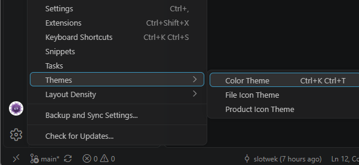

## Extensions
### Themes:
UI extensions:
Extensions --> Filter --> Category --> Themes
Option - VS Code:

- Interesting Theme is: **One Dark Pro**
- Interesting Icons are in: **Material icon Theme**

To manually change Themes:


## AI stuff
*To start with AI press `Ctrl+I`*
In the field write what you want to achieve. In my case:
`How to read csv file with Python pandas` and it generated the code bellow:
> ## Read a CSV file with pandas
> ```python
> import pandas as pd
> 
> df = pd.read_csv("file.csv")
> print(df.head())
> ```
